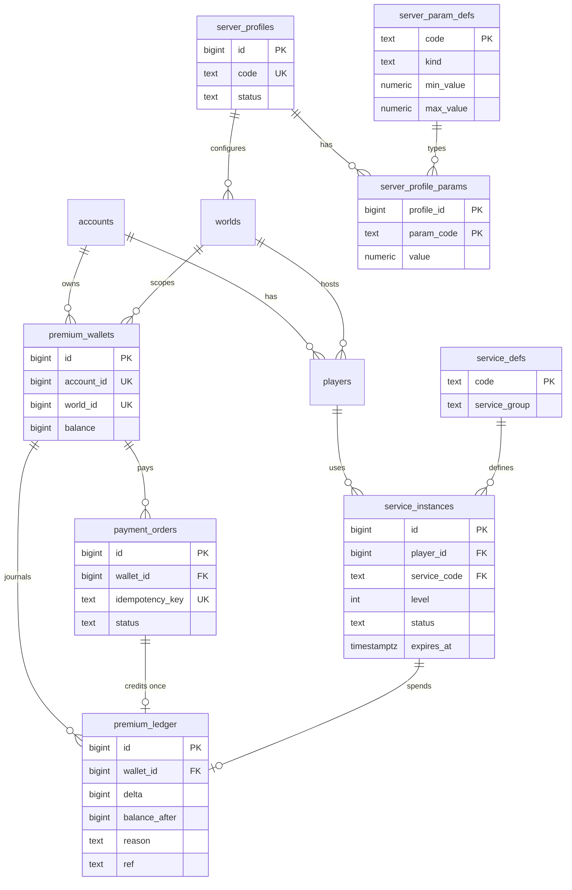

# Проектирование базы данных My Lands

Дата: 2026-11-01. Задача: [ML-D01](../../tasks/mylands/ML-D01.md).
Миграция: `server/migrations/0002_mylands_foundations.sql`.
Тесты: `server/migrations/migrations_test.go`.
Целевая СУБД: PostgreSQL 16.

## 1. Принципы

1. Миграции только добавляют изменения. Файл `0001_init.sql` не меняется.
2. Данные Game Pack остаются в JSON пака. База хранит состояние игрока и ссылки на идентификаторы пака.
3. Каждое изменение состояния выполняется в одной транзакции.
4. Порядок блокировок: `players`, `cities`, `missions`, `heroes`, `tiles`, заказы и предметы.
5. Транзакция не блокирует двух игроков.
6. Правила и формулы остаются в `server/internal/rules`.

### 1.1. Почему определения пака не лежат в таблицах

1. Пак версионируется и закрепляется снимком в `worlds.pack_json`. Второй источник правды создаёт расхождения.
2. Переименование идентификатора требует записи `migrations` в паке. Таблицы определений дублировали бы этот процесс.
3. Значения со статусом `UNKNOWN` и `PROPOSED` меняются часто. Правка JSON дешевле миграции.
4. База хранит только то, что должна защитить ограничениями: владение, баланс, срок, уникальность.
5. Исключение — реестр `service_defs`. Он нужен для внешнего ключа и группы исключительности. Цены и эффекты в него не входят.
6. Реестр `server_param_defs` задаёт тип и диапазон параметра профиля. Значения параметров хранятся типизированно.

## 2. Обзор существующей схемы

Метод: чтение `0001_init.sql` и сверка с правилами `AGENT.md`.
Серьёзность: High — риск потери данных или обхода инварианта. Medium — слабая защита или риск производительности. Low — стиль.

| ID | Серьёзность | Находка | Действие |
|---|---|---|---|
| F-01 | High | `resource_ledger.delta` — JSONB `resourceId -> число`. Это нарушение 1НФ: сумму по ресурсу нельзя проверить SQL | Исправлено в 0003 (ML-B01): таблица `resource_ledger_entries(ledger_id, resource_id, amount)`, данные перенесены. Столбец `delta` устарел и не читается. Осталось удалить `delta` отдельной миграцией. У `resource_id` нет внешнего ключа: ресурсы описаны в Game Pack, не в таблице |
| F-02 | High | `resource_ledger.world_id`, `player_id`, `city_id` без внешних ключей. Журнал может ссылаться на несуществующие строки | Добавлены внешние ключи `NOT VALID` |
| F-03 | Medium | `idempotency_keys.account_id` без внешнего ключа. Строки переживают удаление аккаунта | Добавлен внешний ключ `NOT VALID`, `ON DELETE CASCADE` |
| F-04 | Medium | Нет CHECK на неотрицательность: `cities.population`, `heroes.level/xp`, `tiles.neutral_level`, `jobs.level` | Добавлены CHECK `NOT VALID` |
| F-05 | Medium | Нет CHECK `missions.arrive_at >= depart_at` | Добавлен CHECK `NOT VALID` |
| F-06 | Medium | JSONB-столбцы `techs`, `stats`, `resources`, `buildings`, `units`, `econ_carry` не проверяют тип объекта | Добавлены CHECK `jsonb_typeof = 'object'` |
| F-07 | Medium | Нет индексов на внешних ключах: `players.account_id`, `heroes.home_city_id`, `missions.hero_id`, `tiles.city_id`, `deliveries.*`, `messages.from_player`, `alliance_invites.player_id`, `world_pack_history.world_id`, `alliance_relations.other_id`, `market_orders.city_id` | Добавлены индексы, частичные там, где столбец часто пуст |
| F-08 | Medium | `cities.resources`, `buildings`, `units` — JSONB состояния. Это 1НФ-компромисс | Принято: город читается и блокируется целиком. Нет запросов по отдельному зданию. Пересмотр после замера |
| F-09 | Medium | Нет внешнего ключа `worlds -> профиль сервера` | Добавлен `worlds.profile_id` |
| F-10 | Low | `BIGSERIAL` вместо `GENERATED ALWAYS AS IDENTITY` | Не исправляется: смена требует переписывания последовательностей. Новые таблицы используют IDENTITY |
| F-11 | Low | Статусы — `TEXT` с `CHECK`. Это допустимо для изменяемых наборов | Сохранено. Новые таблицы следуют тому же стилю |
| F-12 | Low | Имя столбца `idempotency_keys.key` совпадает с ключевым словом SQL (не зарезервированным) | Не меняется. Запросы работают |
| F-13 | Low | Нет внешних ключей `reports.world_id` уже есть. `notifications` без `world_id` | Наблюдение. Действий нет |
| F-14 | Low | Остатки производства лежат в `econ_carry` JSONB. Тип значений не проверяется | Наблюдение. Проверяет движок |

Положительные находки:
1. Все времена имеют тип `TIMESTAMPTZ`.
2. Количества — `BIGINT`. Деньги не хранятся в `FLOAT`.
3. Частичные уникальные индексы защищают активные приглашения, названия альянсов и слоты героя.
4. `UNIQUE (kind, ref_id, due_at)` делает события идемпотентными.

### 2.1. Рекомендации на будущее

1. R-1. Выполнено в 0003 как `resource_ledger_entries`. Осталось удалить устаревший `resource_ledger.delta`.
2. R-2. Выполнить `VALIDATE CONSTRAINT` для всех ограничений `NOT VALID` после проверки данных.
3. R-3. Перейти на `IDENTITY` при следующей пересборке таблиц.
4. R-4. Замерить план запросов по `cities` до любой нормализации F-08.

## 3. Целевая модель

Таблицы миграции 0002:

| Таблица | Назначение |
|---|---|
| `server_profiles` | Профиль сервера: код, название, статус |
| `server_param_defs` | Реестр параметров: вид, минимум, максимум, значение по умолчанию |
| `server_profile_params` | Одно типизированное значение на профиль и параметр |
| `premium_wallets` | Кошелёк ЧЖ на пару аккаунт и мир |
| `premium_ledger` | Журнал ЧЖ, только добавление |
| `payment_orders` | Тестовые платёжные заказы |
| `service_defs` | Реестр услуг: код, группа, ссылка на пак |
| `service_instances` | Активные и закрытые услуги игрока |

### 3.1. Профиль сервера

1. Профиль не хранится одним JSONB. Каждый параметр — строка с числовым типом `NUMERIC(14,4)`.
2. Триггер проверяет диапазон из `server_param_defs`.
3. Для вида `integer` триггер отклоняет дробные значения.
4. `worlds.profile_id` связывает мир с профилем. Столбец допускает NULL для старых миров.
5. Миграция не заполняет профили. Значения приходят из конфигурации (ML-D08).
6. Формулы остаются в движке. Таблицы хранят только множители.

### 3.2. Кошелёк ЧЖ

1. Кошелёк принадлежит аккаунту на сервере. Ключ: `UNIQUE (account_id, world_id)`.
2. Баланс не бывает отрицательным: `CHECK (balance >= 0)`.
3. Баланс меняется только вставкой в `premium_ledger`.
4. Триггер вставки блокирует кошелёк, считает `balance_after` и обновляет баланс.
5. Прямое изменение баланса отклоняется триггером `premium_wallet_guard`.
6. Журнал не допускает `UPDATE`, `DELETE` и `TRUNCATE`.
7. Знак `delta` зависит от причины. Покупка, возврат и выдача положительны. Расход и списание отрицательны.
8. Ключ `UNIQUE (wallet_id, reason, ref)` защищает от повторной записи.
9. Представление `premium_wallet_audit` сверяет баланс и сумму журнала.
10. Блокировка кошелька идёт после блокировки `players`. Порядок блокировок не нарушается.

Журнал ЧЖ отделён от `resource_ledger`. Причина: у ЧЖ нет города, а у `resource_ledger` столбец `city_id` обязателен.
Правило «каждый расход и выдача пишут журнал» выполняется для обоих журналов.

### 3.3. Тестовые платежи

1. Провайдер фиксирован: `CHECK (provider = 'mock')`. Валюта фиксирована: `MOCK`.
2. Таблица не хранит данные карт и ответы внешних провайдеров.
3. Ключ идемпотентности уникален на кошелёк: `UNIQUE (wallet_id, idempotency_key)`.
4. Условия заказа неизменяемы после создания.
5. Автомат состояний задаёт триггер `payment_orders_transition`.
6. Разрешены переходы: `created -> pending | cancelled | expired | failed`.
7. Разрешены переходы: `pending -> confirmed | failed | cancelled | expired`.
8. Состояния `confirmed`, `failed`, `cancelled`, `expired` конечные.
9. Состояние `confirmed` требует `confirmed_at`. Триггер заполняет поле сам.
10. Частичный уникальный индекс допускает одну запись `purchase` на заказ. Повторное подтверждение не удваивает ЧЖ.

### 3.4. Платные услуги

1. Цены, сроки и эффекты остаются в паке. Статус значений — `PROPOSED`.
2. `service_defs` хранит код услуги, группу исключительности и идентификатор пака.
3. `service_instances` хранит уровень, начало, окончание, оплаченную цену и статус.
4. Составной внешний ключ `(service_code, service_group)` не допускает расхождения группы.
5. Частичный уникальный индекс `(player_id, service_group) WHERE status = 'active'` оставляет одну активную услугу на группу.
6. Правило «слабый уровень не заменяет сильный» выполняет код (ML-M15). База гарантирует отсутствие двух активных услуг.
7. Закрытая услуга неизменяема. Статусы: `expired`, `cancelled`, `replaced`.
8. Расход ЧЖ ссылается на услугу через `premium_ledger.service_instance_id`.
9. Верхняя граница уровня проверяется кодом по паку. База проверяет только `level >= 1`.

### 3.5. Диаграмма

## 4. Критерии приёмки

1. Миграция применяется на пустой базе. Проверка: `TestMigrationAppliesOnEmptyDatabase`.
2. Миграция применяется поверх 0001 с данными. Проверка: `TestMigrationAppliesOnTopOf0001WithData`.
3. Отрицательный баланс отклонён. Проверка: `TestWalletRejectsNegativeBalanceAndDirectEdits`.
4. Повторный ключ идемпотентности отклонён. Проверка: `TestPaymentOrderIdempotencyAndStateMachine`.
5. Недопустимый переход статуса отклонён. Проверка: тот же тест.
6. Две активные услуги в одной группе отклонены. Проверка: `TestOneActiveServicePerGroup`.
7. Сумма журнала равна балансу. Проверка: `TestLedgerSumEqualsBalanceAndIsAppendOnly`.
8. Диапазон параметра профиля проверяется. Проверка: `TestServerProfileParamsAreTypedAndRanged`.

## 5. Ограничения и непроверенное

1. Ограничения `NOT VALID` не проверяют старые строки до `VALIDATE CONSTRAINT`.
2. Параллельная гонка двух подтверждений платежа не проверена тестом с несколькими соединениями.
3. Код игры (`server/internal/game`) пока не использует новые таблицы. Это задачи ML-M15 и ML-M16.
4. Реальные платежи вне области. Нужен обзор по `AGENT.md`.
5. Файл `server/api/openapi.yaml` не менялся. Новых команд нет.

## 6. Нормализованное состояние города, армии и кристаллов (ML-B02..ML-B04)

Миграции 0004, 0005 и 0006 добавляют таблицы без изменения 0001..0003. Старые столбцы и код остаются.
Данные пака не копируются. Таблицы хранят идентификаторы пака как текст.

### 6.1. Город и здания (0004, ML-B02)

| Таблица | Назначение |
|---|---|
| `city_cells` | Ячейка города: `cell_index` уникален в городе, `obstacle_kind` пустой для свободной ячейки |
| `city_buildings` | Здание на ячейке: `UNIQUE (cell_id)`, `level` от 1 до 9, статус `idle`, `constructing` или `upgrading` |
| `construction_queue` | Очередь: позиция 1..4 на игрока, частичный уникальный индекс `WHERE status = 'queued'` |

1. Уровень `constructing` означает строящийся уровень. Уровень `upgrading` означает уровень до улучшения.
2. Составные внешние ключи удерживают ячейку, здание и очередь в одном городе и у одного игрока.
3. Для этого `cities` получил ограничение `UNIQUE (id, player_id)`.
4. Верхняя граница `cell_index` равна числу ячеек пака. Сервер проверяет её по паку.
5. Перенос: каждая запись `cities.buildings` с уровнем 1..9 становится зданием на ячейке. Ячейки нумеруются по идентификатору здания.
6. Перенос: первые четыре задания `jobs` (`kind = 'build'`, `queued`) на игрока становятся строками очереди.
7. Перенос не копирует уровень 0, уровень выше 9 и задания сверх четырёх на игрока.
8. План отказа: `cities.buildings` и задания `build` в `jobs` устарели. Код Go пока пишет только их. Переключение — отдельная задача.

### 6.2. Армия и герои (0005, ML-B03)

| Таблица | Назначение |
|---|---|
| `unit_groups` | Группа войск: владелец, город, категория, юнит, уровень, `count >= 0`, слот `garrison`, `shelter` или `mission` |
| `hero_placements` | Место героя: гарнизон, убежище или открытая миссия. Ключ `hero_id` |

1. Слот гарнизона уникален: частичный индекс `(city_id, slot_index) WHERE slot_kind = 'garrison'`. Для убежища индекс такой же. Слот миссии уникален в миссии.
2. Составные внешние ключи удерживают владельца. Для них добавлены `UNIQUE (id, player_id)` в `heroes` и `missions`.
3. Верхняя граница уровня юнита задана паком. База проверяет `level >= 1`.
4. Перенос героев: герой с открытой миссией попадает в миссию. Остальные попадают в гарнизон домашнего города.
5. Переноса `unit_groups` нет. В `cities.units` нет категории и уровня. Их берёт сервер из пака при переключении кода.
6. План отказа: `cities.units`, `missions.units` и `heroes.status` остаются, пока код Go не перейдёт на новые таблицы.

### 6.3. Кристаллы, руны и предметы героя (0006, ML-B04)

| Таблица | Назначение |
|---|---|
| `crystal_stocks` | Одна строка на игрока и тип кристалла, `quantity >= 0` |
| `crystal_ledger` | Журнал кристаллов, только добавление |
| `crystal_stock_audit` | Представление сверки остатка и суммы журнала |
| `hero_artefact_slots` | Артефакт героя в слоте: `PRIMARY KEY (hero_id, slot)`, предмет в одном слоте |
| `item_runes` | Руна в артефакте: гнездо 1..5, не более пяти рун |

1. Остаток меняет только вставка в `crystal_ledger`. Триггер блокирует запас, считает `balance_after` и отклоняет отрицательный остаток.
2. Прямое изменение `quantity` отклоняет `crystal_stock_guard`. Журнал не допускает `UPDATE`, `DELETE` и `TRUNCATE`.
3. Каждая строка журнала ссылается на `resource_ledger` и требует запись `resource_ledger_entries` с тем же игроком, типом и количеством.
4. Порядок записи: сначала `resource_ledger` и записи, затем `crystal_ledger`. Блокировка запаса идёт после `players` и `cities`.
5. Тип кристалла и руны — идентификаторы пака. Цены и количества остаются в паке.
6. `hero_artefact_slots` повторяет `items.hero_id` и `items.slot`. Триггер на `items` держит таблицы согласованными. Перенос выполнен для существующих предметов.
7. Переноса кристаллов нет: старые кристаллы лежат в `cities.resources` как обычные ресурсы, и база не знает, какие ресурсы кристаллы.
8. План отказа: `items.hero_id` и `items.slot` устарели. Удаление после переключения кода Go.

## 7. Кланы, союзы и замки (0007, ML-B05)

Миграция 0007 добавляет таблицы без изменения 0001..0006. Старые таблицы и код остаются.
Имена: выпущенная таблица `alliances` хранит клан. Новая таблица `clans` хранит тот же клан. Союз из правила S-01 назван `player_alliances`.

| Таблица | Назначение |
|---|---|
| `clan_roles` | Справочник ролей: `leader`, `officer`, `treasurer`, `war_minister`, `member`. Флаг `singleton` |
| `clans` | Клан: `level >= 1`, `capacity` (NULL — значение пака не записано) |
| `clan_members` | Членство: ключ `player_id` (один клан на игрока), одна роль |
| `player_alliances` | Союз игроков: статус `active`, `breaking`, `dissolved` |
| `player_alliance_members` | Участники союза, не более 7 |
| `clan_pacts` | Мирный договор или объявление войны между кланами |
| `clan_castles` | Замок и клан-владелец, не более 6 замков на клан |
| `castle_standards` | Штандарты замка: ключ `(castle_id, kind)`, `quantity >= 0` |

1. Вместимость клана проверяет триггер `clan_members_capacity` под блокировкой строки клана. Понижение `capacity` ниже числа членов отклонено.
2. Значение вместимости по уровням клана имеет статус `UNKNOWN`. База его не выдумывает. Сервер записывает значение из пака.
3. Роли `leader`, `treasurer`, `war_minister` принадлежат одному члену клана. Проверка выполняется при фиксации транзакции. Передача лидерства в одной транзакции проходит через двух лидеров.
4. Предел 7 участников союза задан правилом S-01 и проверяется триггером под блокировкой строки союза. Предел по уровням науки имеет статус `UNKNOWN`.
5. Разрыв союза: `breaking_started_at` и `break_deadline = breaking_started_at + 24 часа` проверяет `CHECK`. Отмена разрыва отклонена. Переход `active` в `dissolved` минуя `breaking` отклонён. `dissolved_at` не раньше срока. В статусе `breaking` новых участников нет.
6. Неизвестно, может ли игрок состоять в нескольких союзах. База это не ограничивает.
7. `clan_pacts`: не более 3 активных договоров каждого вида на клан, считая обе стороны. Одна активная запись на пару кланов. Активность: `ended_at IS NULL`.
8. `clan_castles`: владелец и время захвата заданы вместе. Замок без владельца защищают монстры. Удаление клана с замками отклонено.
9. Количество и цена штандартов остаются в паке. База проверяет только `quantity >= 0`.
10. Перенос: `alliances` скопированы в `clans` с теми же идентификаторами. `players.alliance_*` скопированы в `clan_members`. Пустая роль становится `member`.
11. Перенос: `alliance_relations` со статусом `nap` и `war` скопированы один раз в `clan_pacts`, одна запись на пару. Записи сверх предела 3 пропущены с уведомлением. Статус `ally` не переносится.
12. Синхронизация: триггеры `alliances_sync_clan` и `players_sync_clan_member` держат `clans` и `clan_members` в согласии с выпущенным кодом. Обратной синхронизации нет.
13. План отказа: `alliances`, `alliance_relations`, `players.alliance_id` и `players.alliance_role` устарели. `clan_pacts` не синхронизируется с `alliance_relations`. Переключение — задача кода Go.
14. Риск: новый клан, созданный прямо в `clans`, получает идентификатор из своей последовательности. Он может совпасть с будущим идентификатором `alliances`, пока выпущенный код пишет туда.
