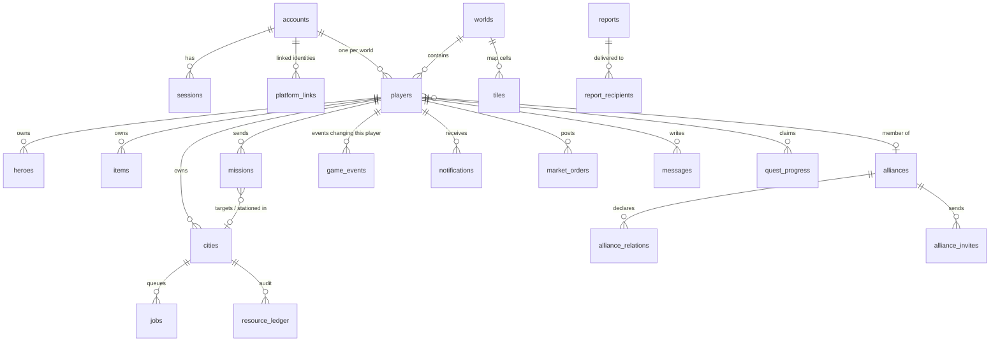

# Data model

Source of truth: `server/migrations/0001_init.sql`. PostgreSQL 16. All times are `timestamptz` (UTC). Resource amounts in city state are **integer milli-units** (`1 unit = 1000`); everywhere else (costs, ledger, cargo, orders) whole units.

## Entity relationships

## Tables

| Table | Purpose | Key constraints / indexes | Written under |
|---|---|---|---|
| `accounts` | login, argon2id hash, guest flag, admin flag, locale, ban, soft delete | `login` unique, format CHECK | account ops |
| `platform_links` | (platform, external_id) → account | PK (platform, external_id) | platform login |
| `sessions` | SHA-256 of bearer token, expiry, revocation | PK token_hash; idx account | login/logout |
| `worlds` | pinned pack snapshot (`pack_json`, version, hash), seed, speed multiplier, status | `slug` unique, speed CHECK | admin/bootstrap |
| `world_pack_history` | audited pack migrations with report | FK world | admin |
| `players` | per-world profile: race, techs (jsonb), stats counters (jsonb), score, protection, alliance & role | unique (world, account), unique (world, lower(name)); idx score | **player lock root** |
| `cities` | aggregate: resources (milli, jsonb), population, `econ_updated_at`, buildings (jsonb id→level), garrison (jsonb), `econ_carry` (fractional remainders) | unique (world, x, y); idx player | player lock |
| `tiles` | terrain, neutral (id, level, `cleared_until`), territory owner & `yield_collected_at`, city ref | PK (world, x, y); partial idx owner | tile lock |
| `jobs` | build/research/train queue items with precomputed `starts_at`/`finishes_at`, cost paid | CHECK finishes > starts; partial idx open per city/player | player lock |
| `game_events` | scheduled events (kind, ref, due, owner player) | unique (kind, ref, due); partial idx (player, due, id) WHERE pending | owner's lock |
| `missions` | units, `upkeep_units`, hero, cargo, options, timings, status, result | partial idx open per player / city / stationed target | mission lock (after players) |
| `heroes`, `items` | heroes (level, xp, skills jsonb, status, wound), items (def, equipped hero/slot) | unique (hero, slot) for equipped items | player lock |
| `reports`, `report_recipients` | battle/scout reports and per-player read state | PK (report, player) | event handler |
| `notifications` | in-game notifications | idx (player, id desc) | insert-only |
| `market_orders` | escrowed offers | CHECK amounts > 0, sell≠buy; partial idx open | order lock |
| `deliveries` | resources owed to a player (processed by their `delivery` event) | — | insert + owner event |
| `alliances`, `alliance_invites`, `alliance_relations` | social structures | unique live name/tag; unique pending invite | alliance row lock |
| `messages`, `player_blocks` | mail, alliance broadcast, report flag, blocks | CHECK exactly one of to_player/alliance | sender |
| `quest_progress` | claimed quests | **PK (player, quest)** ⇒ reward once | player lock |
| `resource_ledger` | append-only audit of every non-production change (spend, grant, loot, trade, admin) | idx (city, id desc) | same tx as change |
| `idempotency_keys` | command dedup: request hash, status, exact response bytes | PK (account, key); 24 h retention | same tx as command |
| `admin_audit` | every admin action with payload | — | admin ops |

## Why JSONB for buildings/units/techs/resources

The city row is the aggregate root and is always read and written whole under the player lock; per-entity rows would multiply writes per settlement without improving consistency. IDs inside JSON are pack IDs, which the pack migration tool rewrites (`applyIDMapping`). Trade-off: no FK from JSON keys to pack definitions — enforced by the pack validator + migration compatibility check instead (decision D-005).

## Transactionality rules

1. Every command = one transaction: idempotency key insert → lock player (+cities) → settle events → validate → mutate → ledger → schedule events → save → store response.
2. No transaction holds two player locks (see ARCHITECTURE §5).
3. Inserts into `notifications`, `reports`, `deliveries`, `game_events` for *other* players are allowed without their lock (insert-only, no economy effect until their own event runs).
4. Monetary-like operations (spend/grant) always write `resource_ledger` in the same transaction.

## Retention (planned)

`idempotency_keys` 24 h (implemented, worker cleanup). Planned: `game_events` done > 30 d, `notifications` > 90 d, `resource_ledger` partitioning by month.
